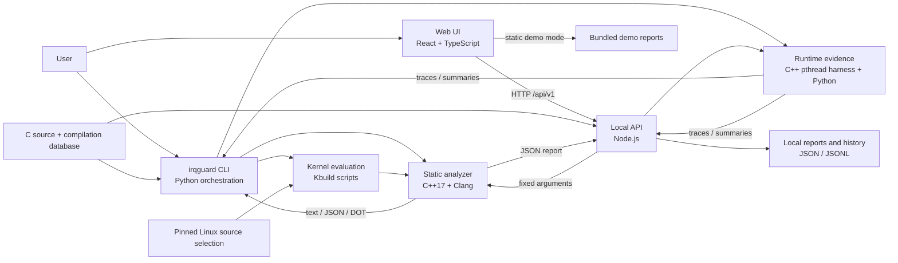

# IRQGuard

**IRQGuard is an independently developed, research-oriented static analyzer for lock-order risks in C programs and selected Linux kernel code.** It uses Clang AST and control-flow information to extract lock operations, propagate lock dependencies across calls, model a bounded subset of hard-IRQ behavior, and report explainable cycle candidates.

IRQGuard was inspired by the research ideas in *When Threads Meet Interrupts: Effective Static Detection of Interrupt-Based Deadlocks in the Linux Kernel* (USENIX Security 2024). It is **not a reproduction of Archerfish**, does not provide formal verification, and does not prove that a program is deadlock-free. A static cycle is a candidate requiring review, not a confirmed deadlock.

## At a glance

- Parses ordinary C with **Clang LibTooling**; no marker syntax is required.
- Extracts functions, calls, selected lock/IRQ APIs, macro locations, and control-flow facts.
- Builds bounded interprocedural summaries and symbolic lock identities.
- Models selected process-context and hard-IRQ interactions, including saved IRQ state for supported `irqsave` / `irqrestore` patterns.
- Emits text, JSON, and Graphviz reports with source provenance and uncertainty.
- Includes a controlled userspace pthread evidence harness, a local web interface, regression fixtures, and a pinned Linux e1000e exploratory evaluation.

## Quick start

After installing the prerequisites and building the analyzer, run it on the included real C example:

```sh
./irqguard analyze --source examples/basic.c
```

The example contains normal C functions and mutex calls. IRQGuard prints the functions, call sites, lock operations, source locations, and any extracted dependency. It does not require special annotations.

Export a JSON report or dependency graph:

```sh
./irqguard analyze --source examples/basic.c --format json --output /tmp/basic-report.json
./irqguard graph --source tests/fixtures/interrupts.c --output /tmp/interrupts.dot
dot -Tsvg /tmp/interrupts.dot -o /tmp/interrupts.svg  # optional; requires Graphviz
```

## Build and test

The analyzer is C++17 and uses the LLVM/Clang development libraries. The documented environment is Ubuntu 24.04 or Ubuntu on WSL 2. LLVM 20 is the tested configuration; use matching LLVM and Clang CMake packages if you build against another installed version.

Install the native build dependencies:

```sh
sudo apt update
sudo apt install -y build-essential cmake ninja-build clang-20 llvm-20-dev libclang-20-dev \
  zlib1g-dev libzstd-dev libedit-dev libcurl4-openssl-dev python3 python3-pip
```

Configure and build:

```sh
cmake -S . -B build -G Ninja \
  -DLLVM_DIR=/usr/lib/llvm-20/lib/cmake/llvm \
  -DClang_DIR=/usr/lib/llvm-20/lib/cmake/clang
cmake --build build -j2
```

Run the C++/Python integration suite:

```sh
ctest --test-dir build --output-on-failure
```

To build and check the frontend, install Node.js 20 or newer and run:

```sh
cd web
npm ci
npm test
npm run build
```

The backend uses Node.js built-in modules and requires Node.js 20 or newer. Check the installed version with `node --version`. Backend syntax can be checked from the repository root with `node --check backend/server.mjs`.

## How the analyzer works

### Project architecture

This view shows how users and the web interface reach the analyzer, and where reports and runtime evidence are stored. The frontend can also run in demo mode using bundled reports, without the backend.



The Node API is a local integration layer: it applies workspace and input limits, launches fixed project tools, and stores results. It does not implement lock analysis. The kernel evaluator prepares bounded compilation inputs and invokes the same analyzer on selected translation units; it does not create a whole-kernel call graph.

### Analysis pipeline

```text
C translation unit + compiler flags + API registry
                     │
                     ▼
           Clang AST and CFG extraction
                     │
                     ▼
      API facts and symbolic lock identities
                     │
                     ▼
    Interprocedural summaries and call graph
                     │
                     ▼
    IRQ state and process/hard-IRQ modeling
                     │
                     ▼
       Candidate cycles and feasibility checks
                     │
                     ▼
         Text, JSON, or Graphviz output
```

The main implementation is in `src/` and its shared model is in `include/deadlock/Model.h`:

1. **Frontend:** Clang LibTooling parses the requested translation unit and records definitions, calls, selected API operations, locations, and supported CFG facts. Parse failures are errors, not successful partial reports.
2. **API recognition:** A configurable registry distinguishes lock acquire/release, IRQ state operations, saved-state operations, and interrupt registration APIs. Macro expansion and spelling locations are retained where Clang provides them.
3. **Interprocedural analysis:** Function summaries propagate supported effects through direct calls and selected resolvable targets. Formal parameters use symbolic identities; unresolved calls, lock identities, and summaries remain uncertainty.
4. **Interrupt model:** The scoped model identifies statically resolvable `request_irq` handler targets and tracks selected local IRQ and irqsave/restore transitions. Restores use saved-state information where available; they are not treated as unconditional enables.
5. **Cycle and feasibility analysis:** Context-labelled edges are searched for cycles. Bounded CFG reasoning can reject some contradictory branch paths; unsupported or incomplete evidence remains inconclusive.

## CLI reference

The `./irqguard` Python wrapper is the main command-line entry point. The compiled C++ binary is available at `build/deadlock-analyzer`.

### Analyze a C translation unit

```sh
./irqguard analyze --source examples/basic.c
./irqguard analyze --source examples/basic.c --format json --output /tmp/basic.json
./irqguard analyze --source examples/basic.c --format dot --output /tmp/basic.dot
```

For project-specific include paths and defines, pass Clang arguments separately:

```sh
./irqguard analyze --source path/to/file.c \
  --clang-arg=-Iinclude --clang-arg=-DCONFIG_EXAMPLE=1
```

Or use the compilation database entry for the translation unit:

```sh
./irqguard analyze --source path/to/file.c --compile-commands path/to/build
```

Compilation-database mode and `--clang-arg` mode are mutually exclusive. Kernel code usually needs the command generated by Kbuild, configured headers, and defines; arbitrary kernel files will not necessarily parse with generic flags.

### Configure the API registry

The built-in registry covers selected mutex, spinlock, IRQ save/restore, local IRQ, and `request_irq` / `free_irq` APIs. Extend or override entries in JSON using `config/apis.example.json`, then validate it:

```sh
./irqguard api-registry validate --config config/apis.example.json
./irqguard analyze --source path/to/file.c --api-config config/apis.example.json
```

Each API entry has a `name` and `kind`, with optional zero-based `lock_argument`, `state_argument`, and `handler_argument` indexes. Adding a name does not automatically give it safe semantics: the analyzer only models recognized operation kinds. See `docs/design-phase3.md` and `docs/design-phase4.md`.

### Runtime evidence and comparisons

The runtime harness is a separate, controlled userspace pthread component. It records wrapper events to JSONL; it is not a kernel tracer and does not emulate hardware interrupts.

```sh
./irqguard runtime run --scenario safe --trace /tmp/safe.jsonl
./irqguard runtime run --scenario deadlock --timeout 1.5 --trace /tmp/deadlock.jsonl
./irqguard runtime summarize --trace /tmp/safe.jsonl --termination completed
```

The supported scenarios are `safe`, `reverse-only`, `opposite-order`, `contention`, `deadlock`, and `static-only`. The deadlock scenario is bounded and watchdog-terminated. To compare a static report with one or more traces, provide an explicit mapping from exact static lock identities to runtime lock IDs:

```sh
./irqguard compare --static-report /tmp/basic.json --lock-map /path/to/lock-map.json \
  --trace /tmp/safe.jsonl --termination completed --output /tmp/comparison.json
```

Absence of an observed order means **not observed**, not disproven. Separate runs are not combined to claim a deadlock. Userspace traces cannot validate a hard-IRQ candidate.

Measure harness overhead against its uninstrumented baseline with:

```sh
./irqguard benchmark runtime --iterations 1000 --repeats 5 \
  --output /tmp/runtime-overhead.json
```

## Web interface

The React/TypeScript interface can be explored with bundled reports without the backend, or connected to the local backend for new analyses and saved history.

### Demo mode

```sh
cd web
npm ci
npm run dev
```

Open `http://localhost:5173`. Demo data includes controlled C examples and saved evaluation reports. Demo reports are examples, not fresh analyzer runs.

### Live analysis mode

Build the C++ targets first, then start the API backend and frontend in separate terminals from the repository root:

```sh
# Terminal 1
export IRQGUARD_ANALYZER="$PWD/build/deadlock-analyzer"
export IRQGUARD_WORKSPACES="$PWD"
export IRQGUARD_DATA_DIR="$HOME/.local/share/irqguard"
cd backend && npm start
```

```sh
# Terminal 2
cd web && npm ci && npm run dev
```

The API listens on `127.0.0.1:8000`; Vite serves the UI on `127.0.0.1:5173` and proxies API requests. `IRQGUARD_WORKSPACES` is a colon-separated allowlist of source roots. The backend rejects source files outside those roots and enforces input/output size and run-time limits. `IRQGUARD_DATA_DIR` controls where local reports and history are stored. The backend does not accept arbitrary shell commands or user-supplied executable paths.

`VITE_STATIC=1 npm run build` produces a static frontend bundle in `web/dist/`; static mode uses bundled data and cannot run a new local analysis.

## Linux kernel evaluation

The saved research evaluation uses Linux stable **v6.6.87**, commit `814637ca257f4faf57a73fd4e38888cce88b5911`, and five selected `drivers/net/ethernet/intel/e1000e` translation units. These are exploratory source measurements, not labeled ground-truth bug cases.

The archived Phase 17 run reports:

| Measure | Recorded result |
|---|---:|
| Translation units analyzed | 5 / 5 |
| Function definitions | 396 |
| Lock operations | 12 (6 acquisitions, 6 releases) |
| Lock dependencies / interrupt graph edges | 0 / 0 |
| Candidate cycles | 0 |
| Uncertainty events | 43,632 |
| Unique uncertainty records | 4,922, summed across per-file reports (not deduplicated across files) |
| Parser diagnostics | 2 |
| Sum of per-file analysis times | 6.993 s |
| Maximum per-process peak RSS | 240,964 KiB |

Those numbers describe that pinned run and tool configuration. Zero dependencies or cycles do not establish deadlock freedom. The dataset contains no independently verified Linux deadlock labels, so precision and recall are not reported. The detailed report, raw metrics, dataset manifest, build-validation evidence, and limitations are in `evaluation/results/phase17/REPORT.md`, `evaluation/dataset-v1.json`, and `docs/phase17-evaluation.md`.

Phase 19.1 independently inventoried every lock operation from archived and fresh reports. All three snapshots agree on **6 acquisitions and 6 releases**. It traced the earlier “10 acquisitions and 2 releases” statement to a documentation error; no extractor misclassification was found. See [`evaluation/results/phase19.1/REPORT.md`](evaluation/results/phase19.1/REPORT.md) and its machine-readable inventory/comparison artifacts.

The later Phase 19.2 uncertainty investigation reran the same five pinned files. It recorded **36,330 uncertainty events, 4,644 category records, and 2,431 unique root causes**, down from the fresh Phase 19.1 baseline of 43,632 events and 2,570 root causes. The reduction came from seven narrowly modeled, source-verified no-lock/no-IRQ effects; unknown helpers and callbacks remain unresolved. No dependencies or cycles were reported, which does not prove deadlock freedom. The [Phase 19.2 report](docs/phase19.2-uncertainty-root-cause.md) documents the root-cause links, per-file results, and limitations. The kernel evaluation page uses the same compact summary served by the local API.

A fresh repeat of the same pinned-source analysis completed all five files with **0 dependencies, 0 graph cycles, and 0 findings**. This scope therefore cannot measure whether feasibility checks reduce inconclusive cycle classifications. The run reproduced 36,330 uncertainty events and 2,431 unique root causes; see the [latest kernel feasibility evaluation](evaluation/results/phase19.3/REPORT.md) and its checksummed evidence bundle.

### Reproducing the selected kernel run

The pinned source checkout is ignored by Git. To create it without changing an existing checkout:

```sh
git clone --branch v6.6.87 --depth 1 https://git.kernel.org/pub/scm/linux/kernel/git/stable/linux.git third_party/linux-v6.6.87
git -C third_party/linux-v6.6.87 rev-parse HEAD
```

Confirm the revision is exactly `814637ca257f4faf57a73fd4e38888cce88b5911`. The runner validates the pin and reports a mismatch instead of silently switching revisions. Build and analyze into a new output directory so archived evidence is preserved:

```sh
python3 evaluation/run_kernel_eval.py \
  --kernel third_party/linux-v6.6.87 \
  --analyzer build/deadlock-analyzer \
  --llvm /usr/lib/llvm-20/bin \
  --output /tmp/irqguard-linux-v6.6.87-rerun \
  --jobs 2
```

The runner prepares a bounded Kbuild compilation database for the selected driver files. It does not analyze the whole kernel or join cross-translation-unit call graphs. Build stages such as object compilation, objtool/ORC validation, final module linking, and stack validation are recorded separately; success at one stage must not be read as success at all stages. The saved evaluation report states exactly which stages ran.

To run the controlled Phase 17 fixture assertions and produce a separate summary (use an output directory that does not already contain evidence):

```sh
python3 evaluation/run_phase17.py \
  --analyzer build/deadlock-analyzer \
  --output /tmp/irqguard-phase17-rerun
```

See `docs/phase17-evaluation.md` for the full protocol, case labels, and comparison with lockdep. A lockdep observation is a runtime result and is not a direct static-analysis oracle.

## Report interpretation

Static reports are schema version 4. They contain extracted functions, calls, API operations, summaries, dependencies, interrupt registrations, context-labelled graph edges, cycle candidates, uncertainty messages/records, and parser diagnostics. Macro locations include expansion and spelling locations when available. Historical schema-v3 reports are supported by the web adapter, but fields absent from those older reports cannot be reconstructed.

The main finding categories are:

| Category | Meaning |
|---|---|
| `candidate_lock_order_cycle` | A process-context lock-order cycle was found in the modeled graph. |
| `interrupt_aware_candidate` | A candidate relies on modeled process-to-hard-IRQ preemption. |
| `rejected_candidate` | A counterfactual interrupt-cycle shape was rejected under a supported, definitely-disabled local IRQ constraint. |
| `inconclusive_analysis` | The path depends on unknown or incomplete state, identity, or other evidence. |

These categories are static classifications, not confirmations of a runtime or kernel deadlock. The analyzer does not attach statistically calibrated risk probabilities.

## Scope and known limitations

- **Translation-unit scope:** analysis is centered on one C translation unit and its available compilation command. Cross-file dependencies are not combined into a whole-kernel call graph.
- **Linux subset:** only registered APIs and selected wrapper/macro patterns have modeled semantics. Unknown operations and unresolved handler targets must be reviewed as uncertainty.
- **Aliasing:** no general whole-program pointer analysis. Heap objects, `container_of` patterns, and ambiguous aliases may remain unresolved; similarly named locks are not sufficient evidence of identity.
- **Path reasoning:** bounded CFG checks cover a subset of branches and conditions. This is not general symbolic execution or an SMT proof. Interprocedural path compatibility can remain unrefined.
- **Execution contexts:** hard IRQ behavior is scoped. Softirqs, tasklets, workqueues, timers, NMIs, and arbitrary kernel execution contexts are not fully modeled.
- **Registration lifecycle:** a `request_irq` call can identify a handler, but static source presence does not prove registration order or that hardware delivered an interrupt. `free_irq` evidence does not establish lifecycle safety.
- **Runtime evidence:** the pthread harness is controlled userspace instrumentation, not kernel tracing and not hardware-IRQ emulation.
- **Evaluation labels:** synthetic fixtures validate specified behaviors; they are not an independent held-out accuracy benchmark. Current Linux cases are exploratory and unlabeled.
- **Validation scope:** selected kernel object/objtool/ORC results do not imply a full kernel build, final module link, or separately configured stack validation.

## Repository layout

```text
src/                 Clang frontend, API registry, summaries, IRQ analysis, reports
include/deadlock/    Shared analyzer data model and interfaces
tests/               Analyzer tests and C regression fixtures
runtime/             Controlled userspace pthread event harness
evaluation/          Dataset manifest, kernel runner, summarizers, saved measurements
docs/                Phase designs, implementation notes, and evaluation methodology
backend/             Local Node.js API for analysis, history, runtime, and evaluation
web/                 React/TypeScript UI and bundled demo reports
examples/            Basic C examples and sample reports
config/              Example configurable API registry
```

## Research relationship

Archerfish is the research inspiration, not an implementation dependency. IRQGuard implements a smaller, independently developed subset centered on Clang extraction, symbolic lock summaries, selected Linux IRQ semantics, bounded feasibility checks, explicit uncertainty, and report provenance. It omits or simplifies parts of the paper’s analysis and does not claim equivalent detection power. See the phase design documents for implementation details and limits.

## Further documentation

- `docs/design-phase1.md` through `docs/design-phase10.md` — analyzer and project phase designs.
- `docs/phase11-cycle-review.md` — review of saved candidate-cycle evidence.
- `docs/phase14-dependency-generation.md` — dependency extraction review.
- `docs/phase15-symbolic-identity.md` — symbolic lock identity and saved IRQ-state work.
- `docs/phase16-feasibility-review.md` — bounded path feasibility and limitations.
- `docs/phase17-evaluation.md` — dataset, reproduction, tool comparison, and evaluation limits.
- `docs/phase18-integration.md` — report comparison, runtime evidence integration, and GUI contract.
- `docs/phase19.2-uncertainty-root-cause.md` — fresh kernel uncertainty baseline, causal call/IRQ tracing, audited effect summaries, and before/after evidence.
- `evaluation/results/linux-v6.6.87/REPORT.md` — pinned kernel evaluation record.
- `evaluation/results/phase17/REPORT.md` — controlled fixture and exploratory kernel run summary.
