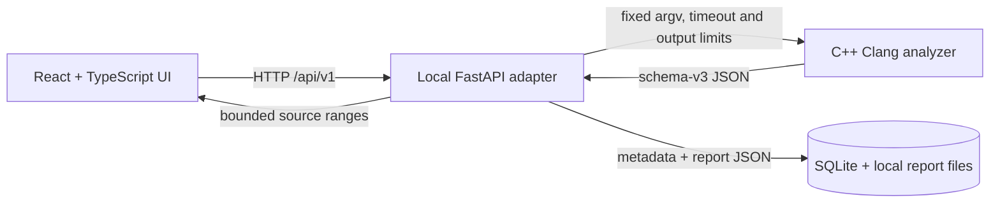

# Interrupt-Aware Deadlock Analyzer

The analyzer uses Clang LibTooling to extract C source facts, computes bounded interprocedural lock summaries, and adds a scoped process/hardirq model. It reports context-labelled lock edges and possible cycle candidates with provenance. A candidate is not a confirmed or runtime deadlock, and the implementation is not equivalent to Archerfish.

## Build on Ubuntu 24.04 / WSL 2

Install the C++ build tools and matching LLVM/Clang development packages:

```sh
sudo apt update
sudo apt install build-essential cmake ninja-build clang-20 llvm-20-dev libclang-20-dev \
  zlib1g-dev libzstd-dev libedit-dev libcurl4-openssl-dev python3 python3-venv \
  python3-pip nodejs npm
```

Build with LLVM 20's CMake package files:

```sh
cmake -S . -B build -G Ninja \
  -DLLVM_DIR=/usr/lib/llvm-20/lib/cmake/llvm \
  -DClang_DIR=/usr/lib/llvm-20/lib/cmake/clang
cmake --build build
ctest --test-dir build --output-on-failure
```

To use a different installed LLVM/Clang version, point `LLVM_DIR` and `Clang_DIR` at that version's `lib/cmake/llvm` and `lib/cmake/clang` directories. The frontend is compiled against the selected development libraries; the Clang executable alone is not sufficient. CMake prefers the dependency development packages above; if only their runtime libraries are present, it can link those directly on common Linux layouts.

## CLI

Parse a standalone source file (defaults to C11):

```sh
build/deadlock-analyzer analyze --source tests/fixtures/extraction.c
```

Write machine-readable JSON:

```sh
build/deadlock-analyzer analyze --source tests/fixtures/extraction.c --format json
```

Use an existing `compile_commands.json` directory, for example one generated for a project build:

```sh
build/deadlock-analyzer analyze --source /path/to/file.c \
  --compile-commands /path/to/build
```

For direct mode, add compiler arguments one at a time:

```sh
build/deadlock-analyzer analyze --source file.c \
  --clang-arg -Iinclude --clang-arg -DCONFIG_EXAMPLE=1
```

Each `--clang-arg` value is the next single argument. Compilation-database mode uses the command recorded for the requested source and does not accept `--clang-arg`.

## Graphical interface (Phase 8)

The optional local GUI uses React, TypeScript, Vite, Tailwind CSS, React Flow, and Recharts. It reads the real schema-v3 analyzer JSON through a small FastAPI adapter; the C++ analyzer remains independent. The backend does not parse terminal output or manufacture graph edges.



Create a backend environment and build the analyzer from the repository root:

```sh
python3 -m venv .venv
source .venv/bin/activate
python -m pip install -r backend/requirements.txt
cmake -S . -B build -G Ninja \
  -DLLVM_DIR=/usr/lib/llvm-20/lib/cmake/llvm \
  -DClang_DIR=/usr/lib/llvm-20/lib/cmake/clang
cmake --build build
```

Start the local API in one WSL terminal. Only paths inside `IRQGUARD_WORKSPACES` are accepted. The default root is the repository. To permit additional workspaces, provide an explicit colon-separated list of existing directories.

```sh
export IRQGUARD_ANALYZER="$PWD/build/deadlock-analyzer"
export IRQGUARD_WORKSPACES="$PWD"
export IRQGUARD_DATA_DIR="$HOME/.local/share/irqguard"
python -m uvicorn irqguard_api.main:app --app-dir backend --host 127.0.0.1 --port 8000
```

In another WSL terminal, start the frontend:

```sh
cd web
npm ci
npm run dev
```

Open [http://localhost:5173](http://localhost:5173) in a Windows browser. WSL 2 localhost forwarding should connect to the development server. If forwarding is unavailable, use the WSL address in the browser while keeping the API bound to loopback and configure the frontend proxy accordingly.

In **New analysis**, enter an absolute Linux path such as `/home/user/project/example.c`. The browser does not browse the WSL filesystem. Optional inputs are a build directory or `compile_commands.json`, and an API-registry JSON file. Raw shell commands and arbitrary Clang arguments are not accepted through the GUI. The backend resolves symlinks before enforcing workspace roots, limits source files to 20 MiB, limits analyzer output streams to 16 MiB each, allows at most two concurrent runs, and terminates a run after 180 seconds by default.

The API is local-only at `127.0.0.1:8000` and exposes versioned routes under `/api/v1`: health, analysis creation/history, report, findings, graph, and bounded source snippets. Reports and run metadata are stored under `~/.local/share/irqguard` by default; set `IRQGUARD_DATA_DIR` to change this. Source files themselves are not copied into the history store. The source panel reads a bounded range from a report-referenced file when requested.

The Overview uses backend-measured duration and counts from the report; missing values are shown as unavailable. History comparisons warn when report schema versions differ. Runtime Evidence and Benchmarks are visibly unavailable because this repository does not implement runtime instrumentation or a benchmark suite. The small JSON under `web/src/test-data` is test-only and is never loaded by the running interface.

Run the GUI checks after installing backend and frontend dependencies:

```sh
source .venv/bin/activate
cmake -S . -B build -G Ninja
cmake --build build
ctest --test-dir build --output-on-failure
cd web
npm test
npm run build
```

See [Phase 8 architecture and API notes](docs/design-phase8.md) for report mapping, security boundaries, persistence, and current UI limits.

### Troubleshooting

- **The UI says the local API is unavailable:** confirm the backend is running on `127.0.0.1:8000` and that the Vite proxy has not been changed.
- **The API says the analyzer is unavailable:** rebuild with `cmake --build build` and confirm `IRQGUARD_ANALYZER` points to the executable.
- **A source path is rejected:** enter an absolute Linux path and add its parent workspace to `IRQGUARD_WORKSPACES`; symlinks resolving outside those roots are intentionally denied.
- **Windows cannot reach the development server:** first check WSL 2 localhost forwarding. The documented frontend and API bind to loopback; do not expose the API on a public interface.
- **A report schema is rejected:** this interface is currently pinned to analyzer JSON schema 3. Update and test the frontend adapter when the analyzer schema changes.

API models can be extended or overridden by name with `--api-config config/apis.example.json`. The configuration is JSON with an `apis` array. Each item has `name`, `kind`, and optional zero-based `lock_argument`, `state_argument`, and `handler_argument` indexes. Built-ins include selected mutex/spinlock operations, `spin_lock_irqsave`/`spin_unlock_irqrestore`, `local_irq_disable`/`local_irq_enable`, `request_irq`, and `free_irq`. See [Phase 3 design](docs/design-phase3.md) and [Phase 4 design](docs/design-phase4.md) for the modeled semantics and limits.

Both human-readable output and JSON preserve expansion and spelling locations. Calls introduced through macros are attributed to their expansion site, with spelling location retained for inspection. Parser errors are printed by Clang and cause a nonzero exit; the analyzer will not emit a successful report for a failed parse.

## JSON example

The report contains `functions`, `calls`, `api_operations`, `call_graph`, `function_summaries`, `lock_dependencies`, `interrupt_registrations`, `interrupt_state_snapshots`, `interrupt_lock_graph`, `interrupt_cycles`, `uncertainties`, and `diagnostics`. A dependency labels itself `direct` when its acquisitions are in one function, or `inferred_through_call` when a summary contributes across a call boundary. Interrupt edges preserve context, source locations, handler registration and call provenance. Cycle findings include a closed lock sequence and one of four categories; use `--format dot` for a Graphviz dependency diagram. These findings are not confirmed runtime deadlocks. The [extraction report](examples/extraction-report.json) and [interrupt fixture report](examples/interrupts-report.json) show the output formats.

An API event retains a symbolic lock identity and location, for example:

```json
{
  "api": "spin_lock",
  "kind": "lock_acquire",
  "caller": "inner",
  "arguments": ["(s)"],
  "lock": {
    "expression": "(s)",
    "syntax": "decl_ref",
    "identity_template": "@param[0]",
    "identity_status": "symbolic",
    "location": {"is_macro": false, "expansion": {}, "spelling": {}}
  },
  "location": {"is_macro": true, "expansion": {}, "spelling": {}}
}
```

Regenerate the report with:

```sh
build/deadlock-analyzer analyze --source tests/fixtures/extraction.c \
  --format json --output examples/extraction-report.json
```

## Current scope

The analyzer parses one requested translation unit and emits AST facts written in that main file. Definitions and calls found only in included headers are treated as unavailable bodies. Direct calls are resolved by declaration. A supported indirect-call pattern is a local/global function-pointer variable initialized or assigned directly to one or more function addresses; targets are unioned conservatively. Other indirect calls are reported as unresolved.

Lock identities use declaration location for variables, structural field/array/unary expressions, and `@param[n]` placeholders for formal parameters. Call-site summaries substitute actual arguments. This does not prove pointer aliasing: structurally different aliases may remain distinct and unknown expressions stay unresolved. Function summaries use Clang CFG blocks, a may-held lock union at joins, and must-release intersection at returns. They do not enumerate paths; branch feasibility and path predicates are not solved. Recursive summaries use a bounded fixed point and cap call-chain provenance at four steps. Limits, unresolved calls, and CFG mapping gaps appear in report uncertainties or diagnostics.

The control-construct list includes `if`, `switch`, loops, and the ternary operator. Macro locations contain expansion and spelling points where Clang exposes them; token-pasting and generated source can produce less intuitive spellings. The interrupt model currently recognizes resolvable `request_irq` registrations and process/hardirq contexts, with path-insensitive enabled/disabled/unknown IRQ-state tracking. Phase 4 rejects counterfactual same-CPU hardirq cycles when the process acquisition is definitely IRQ-disabled; differing branch states remain inconclusive. It does not analyze the full kernel, softirq/NMI contexts, registration lifetime ordering, aliases, or arbitrary Boolean path predicates. See [Phase 2 design](docs/design-phase2.md), [Phase 3 design](docs/design-phase3.md), and [Phase 4 design](docs/design-phase4.md) for details.
